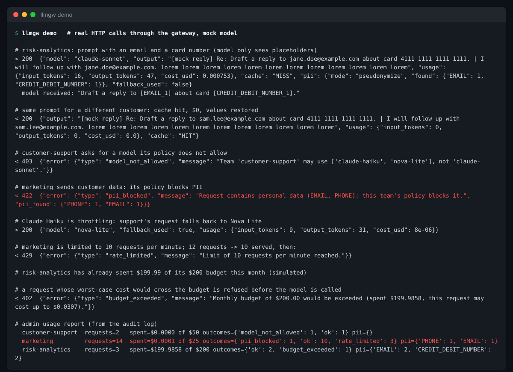
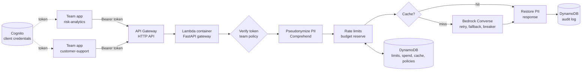

# Enterprise LLM Gateway

[](https://github.com/athulyakollipara-web/enterprise-llm-gateway/actions/workflows/ci.yml)


When a bank decides to "roll out GenAI", every team wants Claude by Friday, and security, finance and compliance each have a question:

- **Security:** who is calling, and can customer data leave the building?
- **Finance:** what will this cost, and who pays?
- **Compliance:** can we show what was sent and by whom?
- **Platform:** what happens when a model is throttled or down?

This gateway answers all four in one place. Teams get one endpoint and a token, and the gateway handles the rest. Onboarding a new team means one command, with no redeploy.



## What it enforces on every request

| Concern | How |
|---|---|
| **Who is calling** | OAuth2 client-credentials tokens from Amazon Cognito. One app client per team, verified on every call (signature, issuer, expiry, scope). |
| **Which models** | Per-team allow-list of model aliases (`claude-sonnet`, `nova-lite`, ...). The platform changes the Bedrock model ID behind an alias in one file, and every team is upgraded without code changes. |
| **Customer data** | PII is replaced with placeholders such as `[EMAIL_1]` **before** the prompt leaves, and put back into the answer, so users see normal replies while the model provider never sees the values. Each team chooses `pseudonymize`, `redact`, `block` or `off`. |
| **Spend** | Monthly budget per team, enforced **before** the call. The worst-case cost is reserved atomically and then settled to the actual cost, so concurrent requests can never jointly overspend. |
| **Fair use** | Requests-per-minute and tokens-per-minute limits per team, with `429` + `Retry-After`. |
| **Outages and throttling** | Retry once, then fall back to the next allowed model. A circuit breaker skips a model that keeps failing. |
| **Repeat questions** | Deterministic requests (`temperature: 0`) are cached per team. Because the cache stores the pseudonymized prompt, it holds no PII and can serve the same answer to different customers. |
| **Audit** | One record per request: team, model, tokens, cost, latency, outcome and PII counts by type. It holds a hash of the prompt, **never the text**. Usage is available as JSON or as a CSV for Tableau. |

## Architecture



The request pipeline lives in [`llmgw/service.py`](llmgw/service.py). Each step runs in a deliberate order:
1. **PII is removed before anything is logged or cached.**
2. **Limits run before the budget is reserved**, so a burst does not tie up the budget.
3. **The budget is reserved before the model call**, so a refused request costs nothing.

## Results

All numbers come from scripts in [`eval/`](eval). They are re-run in CI and checked in under `eval/results/`.

### PII protection ([`eval/pii_eval.py`](eval/pii_eval.py))

The test set has 600 support-style prompts with **880 PII values**. The values come in 29 formats, plus look-alike values that are not PII (dates, amounts, order IDs, zip codes, invoice numbers). Every prompt is sent through the full gateway, and the script checks what the model actually received.

| | Result |
|---|---|
| Recall on the formats the local detector supports | **100%** (EMAIL, card numbers with the Luhn check, routing numbers with the ABA checksum, labeled SSN / account numbers, US phone formats, IPs, AWS keys) |
| Recall on all 880 values | **90.3%** |
| Precision | **99.0%** (the 8 false positives are 16-digit reference numbers that happen to pass the Luhn check, so they are indistinguishable from cards and masked anyway) |
| Values that reached the model | **85 of 880**, all in formats the regex detector is not built for: bare 10-digit phone numbers (25), 9-digit SSNs with no label (30) and account numbers with no label (30) |

**What this means:** the local regex detector is reliable for identifiers that can be validated or that come with a label. Unlabeled bare digit strings need context, which is what Amazon Comprehend adds in AWS mode (it also finds names and addresses). The AWS path is contract-tested, but these figures are for the local detector only. The test set is synthetic, and it was used while building the detector: two gaps it found ("SSN is 123456789" and "SSN on the application: ...") were fixed. Treat it as a regression suite, not an unbiased estimate.

### Reliability, cost control and overhead ([`eval/bench.py`](eval/bench.py))

| Scenario | Without the gateway | With the gateway |
|---|---|---|
| Every model call fails 10% of the time (2,000 requests) | 90.0% succeed | **99.9%** succeed, at 1.11 model calls per request |
| Claude Sonnet fully down (1,000 requests) | 0% succeed | **100%** succeed via Nova Pro. The circuit breaker cuts wasted calls from 3.0 to **1.005** per request. |
| 200 parallel requests against a $0.02 budget | charging after the call: **16% overspend** | reserve-then-settle: **0% overspend** |
| Support workload where 40% of questions repeat | every request calls the model | **39.9%** served from cache, about **40% lower model cost** |
| Gateway processing time per request (single client, mock model at 0 ms) | | **0.24 ms p50**, 3.1 ms p50 end-to-end over HTTP |

The overhead figures come from one local process with SQLite state. On Lambda each container serves one request at a time, so the single-client figure is the relevant one. In production, add the DynamoDB round trips: about six small reads and writes per request.

## Quick start (no AWS account needed)

```bash
pip install -e ".[dev]"
llmgw demo                  # scripted tour: PII, cache, policy, fallback, rate limit, budget
python -m pytest            # 76 tests
python eval/pii_eval.py     # PII evaluation
python eval/bench.py        # load and resilience benchmark
```

Run the server and call it like a team would:

```bash
llmgw serve &                                            # http://127.0.0.1:8080, docs at /docs
TOKEN=$(llmgw token --client dev-customer-support)       # local dev token (Cognito in AWS)
curl -s localhost:8080/v1/chat -H "Authorization: Bearer $TOKEN" -H "content-type: application/json" -d '{
  "model": "claude-haiku",
  "system": "You draft short, polite replies for bank support agents.",
  "messages": [{"role": "user", "content": "Customer jane@example.com asks why card 4111 1111 1111 1111 was charged a late fee."}]
}'
```

Local mode seeds three example teams with different policies (`risk-analytics`, `customer-support`, `marketing`) and uses a mock model. Set `GATEWAY_MODE=aws` to use Bedrock, Comprehend and DynamoDB.

### API

| Method | Path | Scope | Purpose |
|---|---|---|---|
| POST | `/v1/chat` | invoke | Chat completion: `model`, `messages`, optional `system`, `max_tokens`, `temperature` |
| GET | `/v1/models` | invoke | Models this team may use, with prices and fallbacks |
| GET | `/v1/usage` | invoke | This team's usage and budget for the month |
| GET | `/admin/teams` | admin | All team policies |
| PUT | `/admin/teams/{team_id}` | admin | Create or update a team policy |
| GET | `/admin/usage` | admin | Usage for every team |
| GET | `/admin/usage.csv` | admin | Daily usage by team, model and outcome (Tableau-ready) |

Errors always have the same shape: `{"error": {"type", "message", "request_id"}}`. The `type` is one of: `model_not_allowed`, `pii_blocked`, `rate_limited`, `token_rate_limited`, `budget_exceeded`, `upstream_unavailable`, and so on.

## Deploy to AWS

```bash
pip install -e ".[infra]"
cd infra && cdk deploy -c domain_prefix=<unique-prefix>     # needs AWS credentials and Docker
```

This creates:
- a Cognito user pool with a `gateway` resource server, scopes `gateway/invoke` and `gateway/admin`, and a token endpoint
- two DynamoDB tables (TTL, point-in-time recovery)
- a container Lambda running the same Docker image as local, through the Lambda Web Adapter
- an HTTP API with a stage-wide throttle
- an error alarm

Then onboard a team. This is the whole process; see [docs/onboarding.md](docs/onboarding.md) for the full runbook:

```bash
export GATEWAY_MODE=aws COGNITO_USER_POOL_ID=... STATE_TABLE=... AUDIT_TABLE=...   # from the stack outputs
llmgw onboard --team fraud-ops --models claude-haiku,nova-lite --budget 300 --rpm 60 --owner fraud-leads
```

The team exchanges its client ID and secret for a token at the `TokenUrl` output and calls `ApiUrl/v1/chat`.

## Configuration

- **Model catalog:** [`llmgw/models.json`](llmgw/models.json) maps aliases to Bedrock model IDs, prices and fallback chains. The prices are on-demand examples; check Bedrock pricing for your region.
- **Team policy:** allowed models, monthly budget, requests and tokens per minute, max output tokens, PII mode, cache TTL, and an optional Bedrock Guardrail ID.
- **Environment:** see [`llmgw/config.py`](llmgw/config.py) (`GATEWAY_MODE`, `COGNITO_USER_POOL_ID`, `STATE_TABLE`, `AUDIT_TABLE`, `PII_DETECTOR`, ...).

## Design decisions

- **Atomic limits.** Every limit is a single DynamoDB `UpdateItem` with `ADD` and a condition on the current value. Two Lambda containers cannot both take the last unit of a limit, and the benchmark shows what happens without this.
- **Reserve, then settle.** The gateway cannot know the cost until the model answers, so it reserves the worst case (`max_tokens` on the most expensive model in the fallback chain) and refunds the difference. If the call fails, the whole reservation is released.
- **Pseudonymize, not just redact.** Redaction breaks replies ("Dear [REDACTED]"). Placeholders keep the text usable and are reversible, and the mapping lives only in memory for the duration of the request.
- **Tokens are verified in the app.** API Gateway's JWT authorizer needs every client ID in its audience list, so each new team would need a redeploy. Verifying in the app keeps onboarding a data change.
- **Integer micro-dollars.** Spend is stored in millionths of a dollar, so budget arithmetic is exact.
- **Same image everywhere.** The one Dockerfile runs under `docker run`, on Lambda (via the Lambda Web Adapter) or on Fargate.

## Limitations

- The local PII detector does not find names, addresses, or unlabeled digit strings (see the results above). Use `PII_DETECTOR=comprehend` in production.
- The circuit breaker state is per Lambda container, not shared.
- API Gateway HTTP APIs time out after 30 seconds, so very long generations need a lower `max_tokens` or streaming (not implemented yet).
- Text messages only. There is no tool use, images or streaming yet.
- Benchmarks use a mock model. They measure the gateway, not Bedrock.

## Project layout

```
llmgw/
  service.py        request pipeline (policy, PII, limits, cache, budget, fallback, audit)
  app.py            FastAPI routes and error handling
  auth.py           Cognito access-token verification, local dev tokens
  pii.py            regex and Comprehend detectors, pseudonymize / restore
  providers/        Bedrock Converse client and the mock model
  store/            SQLite (local) and DynamoDB (AWS) state
  onboard.py, cli.py
infra/              AWS CDK stack
eval/               PII evaluation and benchmark (+ results)
tests/              76 tests: pipeline, API, AWS contracts (botocore Stubber), CDK assertions
docs/onboarding.md  runbook for onboarding a team
```
